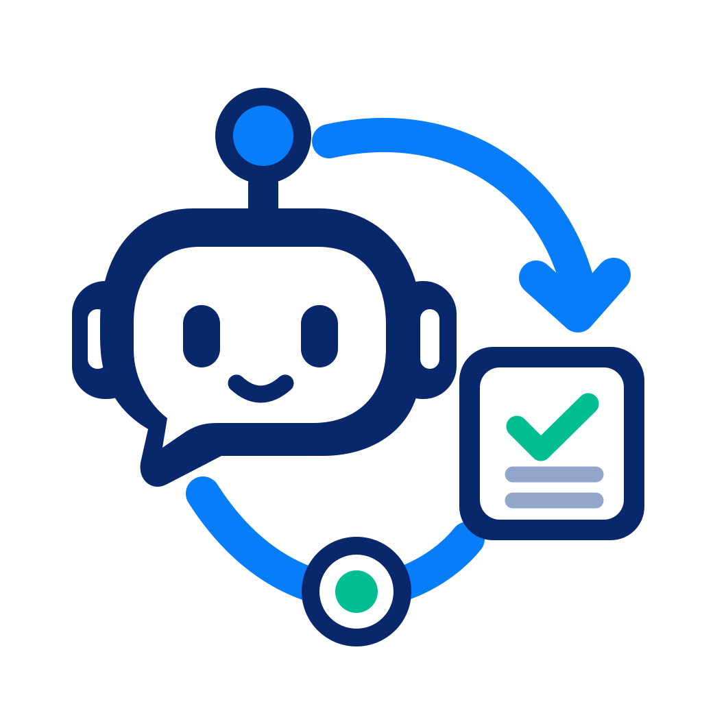

<div align="center">

<h1>AgentJobRelay</h1>

English | [简体中文](README.zh-CN.md)

Tasks run in the background. Agents pick up when needed.

任务在后台运行，Agent 在需要时接棒。
</div>

Run long commands independently of the Agent connection, keep their results, and notify the initiating chat when the host supports it. **v0.1.8 is an unreleased Linux/Windows x86_64 development version.** Desktop wake uses an experimental interface; Windows Desktop continuation is unverified and macOS runtime is unsupported. OpenCode V1 has an experimental plugin package candidate; Claude Code has an inbox-only development framework that needs community verification.

For OpenCode/Claude development setup and evidence boundaries, see [host plugins](docs/host-plugins.md).

## Plugin release candidates

Source is public on [GitHub](https://github.com/MorningFrog/agent-job-relay). Candidate implementations provide the OpenCode npm plugin, shared runtime package and ChatGPT self-hosted marketplace; **npm account verification and final package names are pending, so normal online installation is not available yet.** Maintain existing installations through the offline route below.

The GitHub **Release candidate** workflow runs manually only: it builds artifacts by default or optionally creates a prerelease draft for manual publication. Pushes, PRs and tags never publish. See [release preparation](docs/release.md) for builds, installed-package checks and future online installation. A self-hosted marketplace is separate from OpenAI's official directory.

## Quick install

For Desktop, use a trusted offline bundle for your Linux system. For an existing installation, go directly to [Updating](#updating). For a first installation, open a terminal in the received bundle directory and run:

```bash
./relay plugin bootstrap --dry-run
./relay plugin bootstrap --apply
```

This installs the native runtime and registers its local plugin marketplace. No Rust, Python or Node is needed. Preview is the default; `--apply` writes the installation and owned configuration. There is no public download or automatic online installer yet. If you only have source, see [Build a bundle](#build-a-bundle).

Restart Desktop, open Plugins, select your local marketplace (**AgentJobRelay Local** for a new marketplace), and install/enable AgentJobRelay. Start a new local chat and select the plugin. Host UI discovery still requires manual acceptance on your host version.

Check the default installation:

```bash
AJR_INSTALL_ROOT="${XDG_DATA_HOME:-$HOME/.local/share}/agent-job-relay"
"$AJR_INSTALL_ROOT/relay" --version
"$AJR_INSTALL_ROOT/relay" doctor --client plugin --check-mcp
```

Use your original path for a custom installation. Keep that directory: both MCP and cached terminal launchers use its managed runtime. State and history are stored separately; PATH and system services are unchanged. Already installed? Follow [Updating](#updating). Custom paths and standalone MCP setup are in the [installation guide](docs/installation.md).

## Windows

Use a trusted Windows offline bundle and its `relay.cmd` launcher. Native execution, process-tree supervision, MCP, offline maintenance and installed npm/host-loader behavior are verified in a Windows 11 VM. The 0.1.8 candidate carries both Linux and Windows executables; publication is pending. Windows now starts the daemon on demand, including Codex MCP cleanup jobs, through a verified same-user local CIM bootstrap when needed. If local policy blocks CIM, diagnostics provide a copyable outside-terminal fallback. Follow the [Windows guide](docs/windows.md) for installation, task examples and execution boundaries.

## Use from chat

Ask in a local Desktop chat with the plugin selected:

> Run this project's tests in the background and tell me when they finish.

The Agent binds the current chat, submits the task, ends its turn and reads the result after notification. Everyday prompts need no executable path or session ID. If MCP is unavailable, the workflow reports its CLI fallback. A local terminal is required for binding; ordinary Codex CLI integration provides a notification inbox, without automatic chat continuation.

The first submission or explicit session registration starts the daemon automatically. Commands run with your OS permissions. Job completion, host acknowledgement (`accepted_by_host`) and observed Agent continuation are separate results. For a first acceptance run, follow [manual testing](docs/manual-testing.md); detailed CLI commands and recovery are in [usage](docs/usage.md).

## Updating

Finish active tasks first. Use the **new bundle's launcher**, which also works when the installed version predates plugin-management commands. Set AJR_BUNDLE to the received directory's absolute path and AJR_INSTALL_ROOT to the existing installation:

```bash
"$AJR_BUNDLE/relay" plugin update --root "$AJR_INSTALL_ROOT" --from "$AJR_BUNDLE" --dry-run
"$AJR_BUNDLE/relay" daemon stop --install-root "$AJR_INSTALL_ROOT"
"$AJR_BUNDLE/relay" plugin update --root "$AJR_INSTALL_ROOT" --from "$AJR_BUNDLE" --apply
"$AJR_INSTALL_ROOT/relay" --version
```

The update retains the recorded state/history and a backup, refuses downgrades and never stops a daemon implicitly. Refresh/reinstall the plugin through the host and reconnect MCP afterward. Legacy caches need this host refresh; explicit checked cache repair is described in [installation](docs/installation.md#cache-inspection-and-refresh).

If an install/update or cache replacement was interrupted, use the new bundle's launcher to preview and finish the recorded replacement:

```bash
"$AJR_BUNDLE/relay" plugin repair --path "$AJR_INSTALL_ROOT" --dry-run
"$AJR_BUNDLE/relay" plugin repair --path "$AJR_INSTALL_ROOT" --apply
```

For a cache, pass that exact cache directory instead. Repair preserves history and backups, refuses modified files and never stops a daemon. Retry the original bootstrap/update afterward to finish any remaining steps. See [interrupted operations](docs/installation.md#compatibility-and-interrupted-operations) for limits.

## Uninstalling

Remove/disable the plugin in the host, finish active jobs, then use the same installed launcher:

```bash
"$AJR_INSTALL_ROOT/relay" integration remove plugin --dry-run
"$AJR_INSTALL_ROOT/relay" integration remove plugin --apply
"$AJR_INSTALL_ROOT/relay" daemon stop
"$AJR_INSTALL_ROOT/relay" uninstall --root "$AJR_INSTALL_ROOT" --dry-run
"$AJR_INSTALL_ROOT/relay" uninstall --root "$AJR_INSTALL_ROOT" --apply
```

Uninstall preserves task data and backups. Modified or unknown install files are refused. Host cache removal belongs to the host; there is no data purge command. Standalone MCP removal is covered in the [installation guide](docs/installation.md#uninstalling).

## Troubleshooting

| Symptom | Next step |
|---|---|
| Plugin or MCP tools missing | Refresh the plugin in the host and reconnect. A loaded skill alone does not prove MCP loaded. |
| Local self-check passes, but chat tools fail | Invoke `job_doctor` from the host; a local stdio check does not establish host connectivity. |
| Update reports an active runtime | Finish jobs, then explicitly stop the daemon for the original installation. |
| Notification does not arrive | Check session/delivery state; use same-chat recovery when needed. See [usage](docs/usage.md). |
| Ownership check refuses changes | Preserve the files and inspect the reported changes/backup. |

## Build a bundle

For developers or users without an offline bundle, build from the repository root with Rust stable, Cargo and a C toolchain. The declared Rust 1.89 minimum has not been independently verified; local checks used 1.99.1.

```bash
cargo build --release --locked
AJR_BUNDLE="$PWD/.tmp/agent-job-relay-offline"
./target/release/agent-job-relay plugin pack --output "$AJR_BUNDLE" --dry-run
./target/release/agent-job-relay plugin pack --output "$AJR_BUNDLE" --apply
```

Choose a new output directory for each export. Then use that directory's `relay plugin bootstrap` as in Quick install, or transfer the directory while preserving executable permissions. This is a local delivery artifact, not a marketplace ZIP or published release. See [developer verification](docs/testing.md) for build gates and isolated loader checks.

## Documentation and support

| Topic | Guide |
|---|---|
| Installation, profiles, updates, caches and removal | [Installation](docs/installation.md) |
| CLI, MCP, notifications and recovery | [Usage](docs/usage.md) |
| Human acceptance and expected results | [Manual testing](docs/manual-testing.md) |
| Automated tests and verification scope | [Testing](docs/testing.md) |
| Current support and evidence | [Implementation status](docs/IMPLEMENTATION_STATUS.md), [live evidence](docs/live-e2e.md) |
| Safety and operational limits | [Security](docs/security.md), [limitations](docs/limitations.md) |
| Design and API details | [Architecture](docs/architecture.md), [protocol](docs/protocol.md) |
| Host frameworks and community testing | [Host plugins](docs/host-plugins.md), [Contributing](CONTRIBUTING.md) |
| Release candidates and manual Actions | [Release](docs/release.md) |
| Planned work and changes | [Roadmap](docs/TODO.md), [changelog](CHANGELOG.md) |

Linux execution, offline plugin management and the Codex CLI 0.164.0 loader have isolated automated coverage. Local gates pass on Linux and Windows. Updated native Windows CI/release jobs await a remote run; earlier remote CI covered portable Windows/macOS checks. Desktop 26.1021.22027 with plugin 0.1.5 passed a coordinated active-job restart, rebind and same-chat continuation check, with matching recovery/event/delivery records. UI enablement/version/restart are user-attested; bridge changes were measured and Agent continuation observed. Clean UI installation and other host versions remain unverified. Shared npm runtime/self-hosted marketplace candidates are prepared but unpublished; official directory submission and output monitoring/interruption remain pending. Independent OS installers and package repositories are cancelled.

OpenCode 1.19.4 was checked with its actual loader, MCP and session API using a local simulated model; real-provider sessions and V2 still need verification. Claude Code was checked only through synthetic caller helpers and the actual MCP launcher; no Claude account/loader/model run is claimed. **Community testing and PRs are welcome, especially for Claude Code and container-based version checks.**

MIT licensed. Independently implemented; Vanth was studied read-only for behavior requirements. See [reference audit](docs/reference-audit.md).
